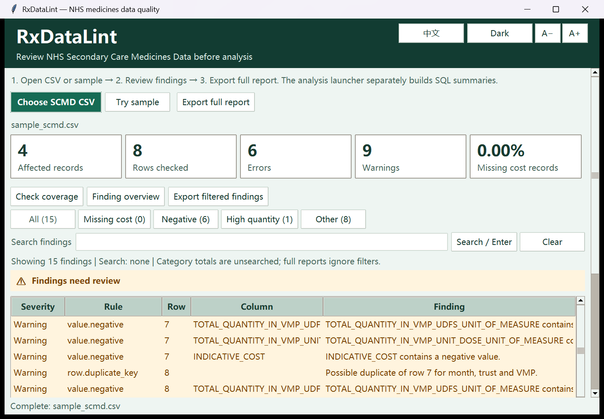

# RxDataLint

做统计前，先检查一下 NHS 药品 CSV。

它读取 NHSBSA 的医院药品数据（SCMD），列出费用缺失、数值格式不对、疑似重复等需要核对的记录。点开问题可以看到原始行，也能生成本地 SQL 汇总和报告。

[下载 Windows 版](https://github.com/rayexzh/rx-data-lint/releases/tag/v0.4.0-alpha.5) · [English](README.md) · [操作说明](docs/INDEX.md)

## 先试一下

1. 下载 ZIP，完整解压。
2. 打开 `Start-Checker.bat`，点击「Try sample／试用示例」。
3. 点开一条提示，查看原始记录，需要的话再导出报告。
4. 要做 SQL 汇总，就打开 `Start-Analysis.bat`，使用示例并点击「生成并验证」。



负数可能是库存调整，费用空白也不能当作零。软件只列出复核线索，不替你判断原始记录一定有错，也不会悄悄修数据。指示性费用不是实际采购支出。

文件在本机处理，不需要账号或付费 API。大文件会占用内存。目前支持 SCMD，不是通用医药数据检查器；项目与 NHS、NHSBSA 没有隶属关系。

## 从源码运行

需要带 Tkinter 的 Python 3.10 或以上版本：

```powershell
python app.py
python analysis/desktop.py
```

[检查规则](docs/RULES.md) · [SQL 用法](analysis/README.zh-CN.md) · [公开数据示例](analysis/CASE_STUDY.md) · [更新记录](CHANGELOG.md) · [MIT 许可](LICENSE)

[BatchScope](https://github.com/rayexzh/batchscope) 是另一个独立工具，用模拟批次记录练习质量分析。
